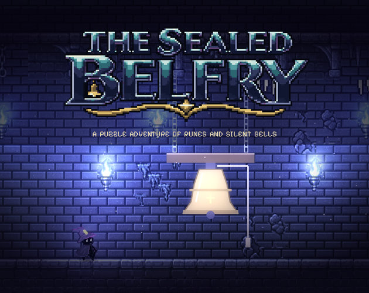
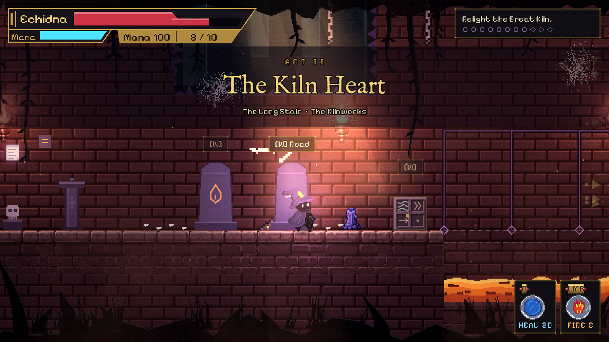

# The Sealed Belfry



A 2D puzzle-platformer about Echidna, a young witch who goes down into a sealed abbey to
ring its great bell. You solve rooms by writing four-word rune sentences (essence, form,
direction, modifier) onto stone cubes: wind to push and lift, fire, ice bridges, light and
portals. Most rooms can be solved more than one way.

Made by **Ishaan Tiwari** and **Aarav Singh** with **Godot 4.7.2**.



## Play

- **In your browser**: <https://ish2601.itch.io/the-sealed-belfry>. No install needed;
  a keyboard and mouse or a controller both work.
- **From source**: install [Godot 4.7.2](https://godotengine.org/download/archive/), clone
  this repository and follow [Running from source](#running-from-source) below.

## What's in the game

- **The story**: Lowbell and Nan's cottage, the Pilgrim Road, the movement tutorial, the
  Sealed Belfry, the Sealed Observatory, the Long Stair and its four wings (the Kilnworks,
  the Drowned Cistern, the Lampworks, the Folded Galleries), and the Eye.
- **Daily Puzzle**: a new generated puzzle every day, the same for everyone, with a score,
  stars, a streak and a board you share with friends by code. Nothing is sent online.
- **Endless**: pick a difficulty and play generated rooms one after another. The rooms get
  harder as you go; three deaths end the run.

## Controls

| Action | Keyboard / mouse | Controller |
|---|---|---|
| Walk | A / D (or arrows) | Left stick, D-pad |
| Jump | Space | A |
| High jump | hold S / Down to crouch, then jump | hold stick down, then A |
| Sprint | hold Shift | LT / LB |
| Fireball | left click (aims at the mouse) | RT (aims with the right stick) |
| Heal (stand still) | Q | X |
| Reload mana (hold) | R | Y |
| Record an Echo / hold to let Echoes fade | E | B |
| Use, pull, ring, inscribe a rune cube | W / Up | D-pad up |
| Pick up / set down a rune cube | F | R3 |
| Rune overview | Tab | Back |
| Pause, map, ledger, settings | Esc | Start |
| Fullscreen | F11 | |

Keys can be changed in **Settings & Controls**, which also has brightness, guidance and
assist options (damage taken, unlimited mana, always sprint, crouch toggle) and reduced
motion.

## Running from source

1. Install Godot 4.7.2 (the standard build; .NET is not needed).
2. Clone the repository:

       git clone https://github.com/F2sh-F2sh/compProject.git

3. Run `godot --headless --path compProject --import` once so Godot builds its import and
   class caches.
4. Open `compProject/project.godot` in Godot and press **F5**. The title screen is the main
   scene.

## Exporting

The export presets are in `export_presets.cfg`:

| Preset | Output |
|---|---|
| Windows Desktop | `builds/windows/TheSealedBelfry.exe` |
| Web | `builds/web/index.html` (zip the folder's contents for itch.io) |
| Handheld (Linux arm64) | built by `bash tools/release/build_handheld_port.sh` (see `port/README.md`) |

Exports need the Godot 4.7.2 export templates. Web builds use Godot's full audio mixer
(`audio/general/default_playback_type.web = Stream`), which the game's audio buses need.

## Project layout

```
assets/      art, fonts, audio and the tileset
data/daily/  the verified table of generated-room solutions
docs/        design documents and guides (see below)
port/        files for the handheld (PortMaster) package
scenes/      levels and reusable scenes (chapter, story, tutorial, player, puzzle, traps, ui, ...)
scripts/     game code, in folders that match scenes/
tests/       automated gameplay tests
tools/       scripts that build levels, art and audio, verify generated rooms, and package builds
```

## Tests

The tests play the levels with simulated input:

    godot --path . --fixed-fps 60 --script res://tests/run_tests.gd -- [suite] [scenario]

Suites: `tutorial`, `chapter`, `presentation`, `experience`, `rune`, `wing`, `prologue`,
`adversarial`, `polish`, `daily`, or `all` (the default). Add `--headless` to run without a
window (screenshots and a few rendering checks are skipped). Screenshots go to
`user://test_shots/`. The tests never touch a real save or settings file.

## Tools

Run with `godot --headless --path . --script res://tools/<folder>/<name>.gd`.

- `tools/levels/`: `build_chapter.gd`, `build_chapter2.gd` and `build_wings.gd` generate the
  chapter and wing scenes (**change those levels here, not in the scene files**);
  `patch_tutorial.gd` edits the hand-built tutorial; `audit_wall_tiles.gd` checks wall art
  stands on the floor.
- `tools/art/`: the sprite, portrait, prop and icon generators.
- `tools/audio/`: the synthesised sound effects and music.
- `tools/procgen/`: `verify_modules.gd` proves every generated room's solutions in the real
  physics and writes `data/daily/verified.json`; `fit_difficulty.gd` and
  `plot_difficulty.py` calibrate the difficulty score.
- `tools/release/build_handheld_port.sh`: the handheld package.

## Documents

- `docs/GAME_DESIGN.md`: the game plan.
- `docs/STORY_PLAYTHROUGH.md`: the story, scene by scene.
- `docs/CHAPTER1_SOLUTIONS.md`, `docs/CHAPTER2_SOLUTIONS.md`: room-by-room solutions.
- `docs/DAILY_PUZZLE.md`, `docs/PROCGEN_DESIGN.md`: the generated levels and their difficulty.
- `docs/PRESENTATION.md`: rendering, light, audio and animation.
- `docs/PLAYTEST_CHECKLIST.md`: what a human playtester should check.
- `docs/IMPLEMENTATION_PROGRESS.md`: the development log.

## License

The code and game files are under the [MIT License](LICENSE), copyright 2026 Ishaan Tiwari
and Aarav Singh. The fonts in `assets/fonts/` are under the SIL Open Font License 1.1;
each font's licence is in its own folder.
